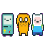

# Codex Adventure Time Pets

**An unofficial Adventure Time pixel companion for Codex.**

Bring Finn, Jake, and BMO to your coding workspace with expressive frame-by-frame animations and interactive reactions to your Codex workflow.

### Features

- **Finn, Jake & BMO** — Three familiar characters brought together as a pixel-art companion squad.
- **Rich Sprite Animations** — Detailed frame-by-frame movement, expressions, and character reactions.
- **Expressive Status Feedback** — Sprite states cover coding, waiting, review, failure, movement, and task completion moments.
- **Pixel-Art Aesthetic** — A cohesive retro animation style inspired by *Adventure Time*.

### Dynamic demo



The GIF is a low-resolution preview of the idle row. The complete 1536 × 1872 atlas is available at [`assets/pixel-trio-spritesheet.png`](./assets/pixel-trio-spritesheet.png) for local playback and inspection.

### Disclaimer

This is an unofficial, fan-made project and is not affiliated with, sponsored by, or endorsed by the creators or rights holders of *Adventure Time* or by OpenAI.

Finn, Jake, BMO, and *Adventure Time* belong to their respective rights holders. This project does not claim ownership of these characters.

Any license applied to the original source code does not grant permission to reuse third-party characters or artwork.

## Inspiration and attribution

*Adventure Time* was created by Pendleton Ward. The project began as a Frederator Studios short and later became a Cartoon Network series.

- [Frederator Studios introduction to Adventure Time](https://frederatorstudios.com/shows/adventure-time/)
- [Warner Bros. Discovery official material](https://press.wbd.com/us/media-release/hbo-max/hbo-max-orders-four-adventure-time-distant-lands-specials-cartoon-network-studios)
- [Cartoon Network trademark notice](https://www.cartoonnetwork.com/legal/trademark.html?atclk_gn=un_community)

## Repository contents

- `assets/pixel-trio-spritesheet.png` contains the complete 8 × 9 atlas used by the examples.
- `preview/` contains low-resolution previews, including the animated idle demo.
- `docs/sprite-layout.md` documents the 8 × 9 sprite atlas layout.
- `docs/animation-states.md` documents the nine available animation rows and their populated frame counts.
- `docs/installation.md` explains how to preview the examples and connect a local sprite sheet.
- `examples/css-spritesheet.html` demonstrates CSS background positioning.
- `examples/canvas-spritesheet.html` demonstrates Canvas frame drawing.

## Installation and local preview

See [docs/installation.md](./docs/installation.md) for the complete setup. The shortest path is:

```bash
git clone https://github.com/bukeke111/adventure-time-pets.git
cd adventure-time-pets
python3 -m http.server 8000
```

Then open the CSS or Canvas example at `http://localhost:8000/examples/`.

The examples use `assets/pixel-trio-spritesheet.png`, which is 1536 × 1872 pixels with 192 × 208 pixel cells. This is third-party fan artwork. Keep the attribution and rights notice when redistributing it, and do not treat the MIT or CC BY licenses in this repository as permission to reuse the Adventure Time characters.

## Licenses

- Example source code is released under the [MIT License](./CODE_LICENSE.md).
- Documentation is released under [CC BY 4.0](./LICENSE).
- The *Adventure Time* characters and related artwork are excluded from those licenses.
