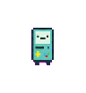
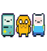
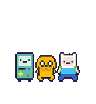
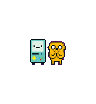
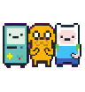

<div align="center">

# Codex Adventure Time Pets

**An unofficial Adventure Time pixel companion for Codex.**

Bring Finn, Jake, and BMO to your coding workspace with expressive frame-by-frame animations and workflow status reactions.

[](https://github.com/bukeke111/adventure-time-pets)
[](./assets/pixel-trio-spritesheet.png)
[](./CODE_LICENSE.md)
[](./LICENSE)
[](#third-party-materials-and-disclaimer)

<br>


<p>
  <a href="#quick-start">Quick start</a>
  ·
  <a href="#中文索引">中文说明</a>
  ·
  <a href="./docs/animation-states.md">Animation states</a>
  ·
  <a href="./docs/installation.md">Installation</a>
</p>


</div>

## Contents

- [Features](#features)
- [Dynamic preview](#dynamic-preview)
- [Animation gallery](#animation-gallery)
- [Quick start](#quick-start)
- [Sprite sheet](#sprite-sheet)
- [Animation states](#animation-states)
- [Repository layout](#repository-layout)
- [Licenses](#licenses)
- [Third-party materials and disclaimer](#third-party-materials-and-disclaimer)
- [中文索引](#中文索引)

## Features

- **Finn, Jake & BMO** — Three characters brought together as a pixel-art companion squad.
- **Rich sprite animations** — Nine workflow-oriented animation states with populated frame sequences.
- **Expressive status feedback** — Idle, running, waiting, review, failure, movement, and celebration states.
- **Codex-friendly atlas** — A fixed 8 × 9 layout with 192 × 208 pixel cells.
- **Browser examples** — CSS and Canvas examples show how to load and play one row.

## Dynamic preview

The animated preview shows the six-frame `idle` row at half cell size.


## Animation gallery

Each state has its own frame sequence. Open any GIF to inspect the motion at full preview size.

<table>
  <tr>
    <td align="center"><strong>idle</strong><br><br><sub>6 frames</sub></td>
    <td align="center"><strong>running-right</strong><br><br><sub>8 frames</sub></td>
    <td align="center"><strong>running-left</strong><br><br><sub>8 frames</sub></td>
  </tr>
  <tr>
    <td align="center"><strong>waving</strong><br><br><sub>4 frames</sub></td>
    <td align="center"><strong>jumping</strong><br><br><sub>5 frames</sub></td>
    <td align="center"><strong>failed</strong><br><br><sub>8 frames</sub></td>
  </tr>
  <tr>
    <td align="center"><strong>waiting</strong><br><br><sub>6 frames</sub></td>
    <td align="center"><strong>running</strong><br><br><sub>6 frames</sub></td>
    <td align="center"><strong>review</strong><br><br><sub>6 frames</sub></td>
  </tr>
</table>

The complete atlas is available here:

[Open `assets/pixel-trio-spritesheet.png`](./assets/pixel-trio-spritesheet.png)

## Quick start

Clone the repository and start a local static server:

```bash
git clone https://github.com/bukeke111/adventure-time-pets.git
cd adventure-time-pets
python3 -m http.server 8000
```

Open the examples:

- <http://localhost:8000/examples/css-spritesheet.html>
- <http://localhost:8000/examples/canvas-spritesheet.html>

The examples load `assets/pixel-trio-spritesheet.png` automatically.

For the full setup and runtime integration notes, see [docs/installation.md](./docs/installation.md).

## Sprite sheet

| Property | Value |
| --- | --- |
| Atlas version | v1 |
| Dimensions | 1536 × 1872 px |
| Grid | 8 columns × 9 rows |
| Cell size | 192 × 208 px |
| File | `assets/pixel-trio-spritesheet.png` |

A frame at column `column` and row `row` starts at:

```text
x = column × 192
y = row × 208
```

See [docs/sprite-layout.md](./docs/sprite-layout.md) for the coordinate convention.

## Animation states

| Row | State | Frames | Intended feedback |
| ---: | --- | ---: | --- |
| 0 | `idle` | 6 | Calm breathing and waiting loop |
| 1 | `running-right` | 8 | Moving toward the right |
| 2 | `running-left` | 8 | Moving toward the left |
| 3 | `waving` | 4 | Greeting or acknowledgement |
| 4 | `jumping` | 5 | Positive transition or celebration |
| 5 | `failed` | 8 | Error, failure, or blocked task |
| 6 | `waiting` | 6 | Waiting for input or an external step |
| 7 | `running` | 6 | Work in progress |
| 8 | `review` | 6 | Reviewing or checking a result |

More playback guidance is available in [docs/animation-states.md](./docs/animation-states.md).

## Repository layout

```text
assets/
└── pixel-trio-spritesheet.png   # Complete v1 atlas

preview/
├── pixel-trio-idle.gif          # Low-resolution dynamic preview
└── states/                      # Nine animated state previews

docs/
├── animation-states.md
├── installation.md
└── sprite-layout.md

examples/
├── canvas-spritesheet.html
└── css-spritesheet.html
```

## Licenses

- Example source code is released under the [MIT License](./CODE_LICENSE.md).
- Documentation is released under [CC BY 4.0](./LICENSE).
- The Adventure Time characters and related artwork are excluded from those licenses.

## Third-party materials and disclaimer

This is an unofficial, fan-made project. It is not affiliated with, sponsored by, or endorsed by the creators or rights holders of *Adventure Time*, or by OpenAI.

Finn, Jake, BMO, and *Adventure Time* belong to their respective rights holders. This project does not claim ownership of these characters.

The complete sprite sheet in `assets/` contains third-party character artwork. The repository licenses apply to the original code and documentation only. They do not grant permission to reuse, redistribute, or commercialize the third-party characters or artwork. Keep this attribution and rights notice when sharing the asset.

- [Frederator Studios introduction to Adventure Time](https://frederatorstudios.com/shows/adventure-time/)
- [Warner Bros. Discovery official material](https://press.wbd.com/us/media-release/hbo-max/hbo-max-orders-four-adventure-time-distant-lands-specials-cartoon-network-studios)
- [Cartoon Network trademark notice](https://www.cartoonnetwork.com/legal/trademark.html?atclk_gn=un_community)

## 中文索引

- [项目简介](#项目简介)
- [功能亮点](#功能亮点)
- [动态演示](#动态演示)
- [九种动画状态预览](#九种动画状态预览)
- [快速开始](#快速开始)
- [精灵图规格](#精灵图规格)
- [动画状态](#动画状态)
- [目录结构](#目录结构)
- [许可证](#许可证)
- [第三方素材与版权声明](#第三方素材与版权声明)

## 项目简介

这是一个用于 Codex 工作区的非官方《探险活宝》像素虚拟宠物项目，由 Finn（阿宝）、Jake（老皮）和 BMO 组成。

项目重点是用连续动作帧表达编码过程中的状态变化，让宠物在待机、运行、等待、审核、失败和完成等阶段呈现不同反馈。

## 功能亮点

- **动作帧丰富**：当前精灵图包含 9 类动画状态，共 55 个已填充帧位。
- **角色组合明确**：Finn、Jake 和 BMO 在同一精灵图中保持统一像素比例和视觉节奏。
- **状态反馈清晰**：动画状态可以对应 Codex 工作流中的运行、等待、审核和失败节点。
- **接入方式简单**：固定尺寸和行列布局适合 CSS 背景定位和 Canvas 绘制。
- **可直接预览**：仓库提供动态 GIF、完整精灵图以及浏览器示例。

## 动态演示

动态 GIF 展示 `idle` 待机状态。完整精灵图位于 [assets/pixel-trio-spritesheet.png](./assets/pixel-trio-spritesheet.png)。


## 九种动画状态预览

README 直接展示九种状态的 GIF。对应的帧数和工作流含义见 [动画状态](#动画状态) 与 [docs/animation-states.md](./docs/animation-states.md)。

- [idle](./preview/states/idle.gif)
- [running-right](./preview/states/running-right.gif)
- [running-left](./preview/states/running-left.gif)
- [waving](./preview/states/waving.gif)
- [jumping](./preview/states/jumping.gif)
- [failed](./preview/states/failed.gif)
- [waiting](./preview/states/waiting.gif)
- [running](./preview/states/running.gif)
- [review](./preview/states/review.gif)

## 快速开始

```bash
git clone https://github.com/bukeke111/adventure-time-pets.git
cd adventure-time-pets
python3 -m http.server 8000
```

然后打开：

- <http://localhost:8000/examples/css-spritesheet.html>
- <http://localhost:8000/examples/canvas-spritesheet.html>

完整安装步骤见 [docs/installation.md](./docs/installation.md)。

## 精灵图规格

- 完整尺寸：1536 × 1872 px
- 网格：8 列 × 9 行
- 单元格：192 × 208 px
- 文件路径：`assets/pixel-trio-spritesheet.png`

详细坐标规则见 [docs/sprite-layout.md](./docs/sprite-layout.md)。

## 动画状态

| 行 | 状态 | 帧数 | 用途 |
| ---: | --- | ---: | --- |
| 0 | `idle` | 6 | 待机循环 |
| 1 | `running-right` | 8 | 向右移动 |
| 2 | `running-left` | 8 | 向左移动 |
| 3 | `waving` | 4 | 打招呼或回应 |
| 4 | `jumping` | 5 | 庆祝或积极转场 |
| 5 | `failed` | 8 | 失败、错误或阻塞 |
| 6 | `waiting` | 6 | 等待输入或外部步骤 |
| 7 | `running` | 6 | 工作进行中 |
| 8 | `review` | 6 | 检查或审核结果 |

## 目录结构

```text
assets/                 完整精灵图
preview/                动态 GIF 预览和九种状态图
docs/                   布局、安装和动画状态说明
examples/               CSS 与 Canvas 示例
```

## 许可证

- 示例代码采用 [MIT License](./CODE_LICENSE.md)。
- 文档采用 [CC BY 4.0](./LICENSE)。
- 《探险活宝》角色和相关美术素材不包含在上述许可证中。

## 第三方素材与版权声明

这是个人制作的非官方同人项目，与《探险活宝》创作者、版权方、Cartoon Network、Warner Bros. Discovery 或 OpenAI 没有合作、授权或背书关系。

Finn、Jake、BMO 和《探险活宝》属于相应权利方。本项目不主张拥有这些角色的版权。

`assets/` 中的完整精灵图含有第三方角色美术素材。仓库许可证只适用于原创代码和文档，不授予第三方角色或美术素材的再使用、再分发或商业使用许可。分享素材时请保留这段版权说明。

